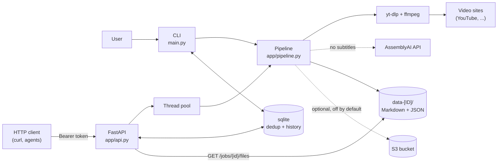

# contexty

A Python wrapper around `yt-dlp` + `ffmpeg`: give it a video URL (or a
YouTube ID) and it produces a `data-[ID]/` folder of Markdown — transcript,
metadata and an index — ready to be used as context by other tools and
agents.

Transcription prefers the video's own subtitles (fetched with `yt-dlp`,
free and instant) and falls back to [AssemblyAI](https://www.assemblyai.com/)
only when there are none.

```
data-dQw4w9WgXcQ/
├── README.md        # index
├── metadata.md      # title, channel, duration, language, transcript source, description...
├── metadata.json    # machine-readable twin of metadata.md + a naive transcript excerpt
├── transcript.md    # transcript (speaker labels/timestamps when diarization is on)
├── audio.m4a        # optional, with --keep-audio
└── video.mp4        # optional, with --keep-video
```

It runs two ways off the same pipeline code (`app/pipeline.py`):

1. **CLI** (`main.py`) — synchronous, writes `data-[ID]/` to the current
   directory.
2. **HTTP API** (`app/api.py`, FastAPI) — submit a job, poll its status,
   fetch the generated files. Jobs run in a small in-process thread pool;
   no queue or broker.

> **Note:** this repository is an automated export of another, private
> repository. It documents local installation only. Some details (internal
> docs, deployment, operational notes) were deliberately left out, so parts
> may be missing or under-explained; issues pointing them out are welcome.

## Topology



The CLI and the API share the same pipeline. Solid edges are always used;
dashed edges are a fallback (AssemblyAI, only when a video has no subtitles
of its own) or opt-in (S3 copy).

## Prerequisites

- Python **3.14** (e.g. `pyenv install 3.14`) and
  [Pipenv](https://pipenv.pypa.io/)
- `ffmpeg` and `ffprobe` on your `PATH` (`apt install ffmpeg`,
  `dnf install ffmpeg`, `brew install ffmpeg`, ...)
- An [AssemblyAI API key](https://www.assemblyai.com/app/account) — see
  [Limitations](#limitations-of-the-public-edition)
- Optional: `podman` or `docker`, to run the API in a container

## Installation

```bash
git clone https://github.com/aldrinleal/contexty-public.git contexty
cd contexty
make install            # pipenv install --dev
cp .env.example .env    # then fill in ASSEMBLYAI_API_KEY (and CONTEXTY_API_TOKEN for the API)
```

## Local configuration

Everything is configured through environment variables, read from `.env`
(see `.env.example` for the full, commented list and `app/config.py` for
defaults).

| Variable | Required | Purpose |
|---|---|---|
| `ASSEMBLYAI_API_KEY` | yes (CLI) | AssemblyAI key, used when a video has no subtitles |
| `CONTEXTY_API_TOKEN` | yes (API) | Bearer token every API route except `/healthz` requires |
| `CONTEXTY_OUTPUT_DIR` | no | Where `data-[ID]/` folders go (default `.`) |
| `CONTEXTY_DB_PATH` | no | sqlite file for the 24h dedup guard + job history (default `contexty.db`) |
| `CONTEXTY_ENABLE_HISTORY_GUARD` | no | `false` disables the dedup guard (no db file) |
| `CONTEXTY_PREFER_NATIVE_SUBTITLES` | no | `false` always transcribes with AssemblyAI |
| `CONTEXTY_COOKIES_FILE` / `CONTEXTY_COOKIES_FROM_BROWSER` | no | YouTube bot-check workaround, see below |
| `CONTEXTY_ENABLE_S3_SYNC` | no | Copy each finished job to `s3://$CONTEXTY_S3_BUCKET/data/{id}/` (default `false`) |

## Running

### CLI

```bash
make run ARGS="https://youtu.be/dQw4w9WgXcQ"
make run ARGS="dQw4w9WgXcQ --keep-audio --keep-video --language pt"
# or: pipenv run python main.py <url-or-id> [flags]
```

- `--keep-audio` — keep `audio.<ext>` in the output.
- `--keep-video` — download the full video and keep `video.<ext>`.
- `--language` — force the transcript language (ISO 639-1, e.g. `pt`, `en`).
- `--force-assemblyai` — skip native subtitles, always use AssemblyAI.
- `--cookies-from-browser BROWSER` — read YouTube cookies from a local
  browser profile (`chrome`, `firefox`, `edge`, `brave`, `safari`, ...).

A bare ID is treated as a YouTube video; any URL `yt-dlp` supports works.

### HTTP API

```bash
make api      # uvicorn --reload on http://127.0.0.1:8000
```

```bash
TOKEN=<your CONTEXTY_API_TOKEN>
BASE=http://localhost:8000

# submit — returns 202 immediately; the pipeline runs in the background
curl -s -X POST "$BASE/jobs" \
  -H "Authorization: Bearer $TOKEN" -H "Content-Type: application/json" \
  -d '{"source": "https://youtu.be/dQw4w9WgXcQ", "keep_audio": false, "language": null}'

# poll until status is "completed" or "error"
curl -s "$BASE/jobs/dQw4w9WgXcQ" -H "Authorization: Bearer $TOKEN"

# recent jobs
curl -s "$BASE/jobs" -H "Authorization: Bearer $TOKEN"

# fetch a generated file
curl -s "$BASE/jobs/dQw4w9WgXcQ/files/transcript.md" -H "Authorization: Bearer $TOKEN"
```

### Running in a container

```bash
make container-build
make container-run            # add VOLUME_OPTS=:Z on SELinux hosts; CONTAINER=docker for docker
```

The API listens on `http://localhost:8000`; output and the sqlite db land
in `./data/`.

### YouTube cookies (bot-check)

YouTube sometimes answers `yt-dlp` with a "confirm you're not a bot" wall.
Both workarounds are built into `yt-dlp`:

- **CLI**: `--cookies-from-browser firefox` (or
  `CONTEXTY_COOKIES_FROM_BROWSER`) reads a logged-in browser profile
  directly.
- **API / container** (no browser available): point
  `CONTEXTY_COOKIES_FILE` at a Netscape-format `cookies.txt`, or upload one
  to a running API:
  ```bash
  pip install browser_cookie3                        # helper-only dependency
  python scripts/export-cookies.py --browser firefox # writes cookies.txt
  scripts/upload-cookies.sh cookies.txt --token "$TOKEN"   # PUT /cookies on localhost:8000
  ```
  `GET /cookies` reports status only (never the cookie values).
  `cookies.txt` is git-ignored — never commit it.

## How it works

```
POST /jobs
   -> resolve_metadata() + jobstore.claim()     [synchronous, fast]
   -> 202 {id, duplicate, status_url}
   -> background thread:
        native subtitles via yt-dlp, else AssemblyAI (submit + poll)
        -> format Markdown -> write data-[ID]/
        -> optional S3 copy -> jobstore.mark_completed / mark_failed
```

- **Dedup guard**: a job "claims" its video ID in sqlite for 24h; a repeat
  within that window is skipped (no download, no AssemblyAI spend).
- **`metadata.json`'s `summary`** is a naive whitespace-collapsed excerpt
  of the transcript, not an AI summary (`summary_is_ai_generated: false`).

```
app/
├── config.py       # Settings (pydantic-settings), every env var
├── extractor.py    # yt-dlp + ffmpeg/ffprobe
├── subtitles.py    # VTT/SRT parser for native subtitles
├── transcriber.py  # AssemblyAI (submit / check_status / fetch_transcript)
├── formatter.py    # builds the Markdown/JSON files
├── output.py       # writes data-[ID]/
├── jobstore.py     # sqlite dedup guard + job history
├── s3sync.py       # optional `aws s3 sync` copy
├── pipeline.py     # the whole download -> transcribe -> write flow
└── api.py          # FastAPI app
main.py             # CLI
scripts/            # cookie export/upload helpers
```

## Tests

```bash
make test     # pytest — offline, no API keys needed
make lint     # black --check / isort --check / mypy
```

## Resetting the environment

```bash
make reset    # removes data-*/, ./data/ and contexty.db
```

## Limitations of the public edition

- **Network access is inherent**: videos are fetched from their source
  sites by `yt-dlp`, and the AssemblyAI fallback is a paid external API.
  There is no offline mode.
- **The CLI requires `ASSEMBLYAI_API_KEY` at startup**, even for videos
  that end up transcribed from their own subtitles.
- **S3 sync is off by default.** Turning it on needs the AWS CLI
  credentials in your environment and a bucket you own.
- No license file has been chosen yet — all rights reserved until one is
  added.
